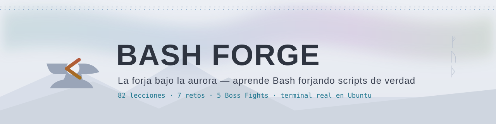
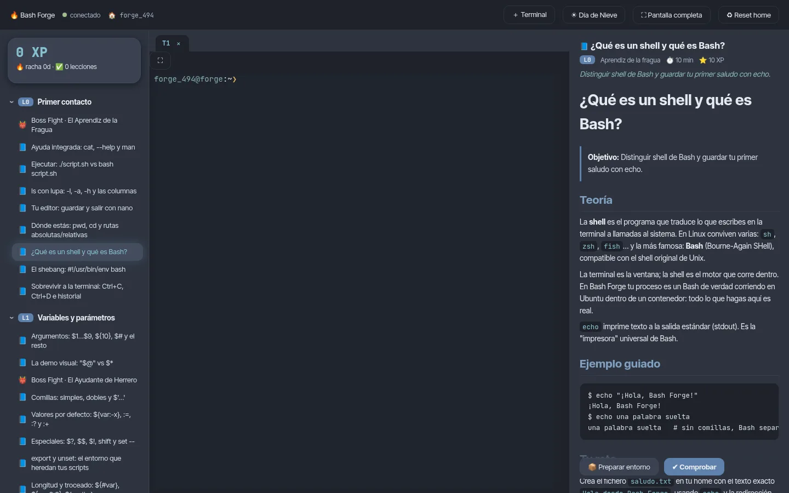
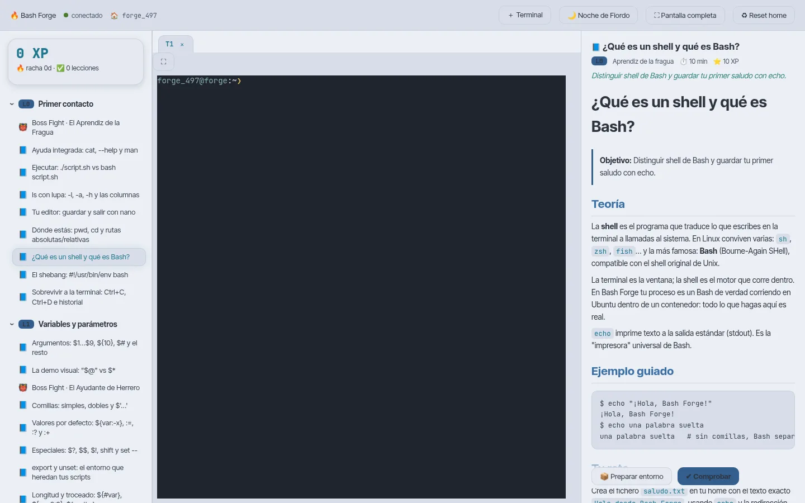
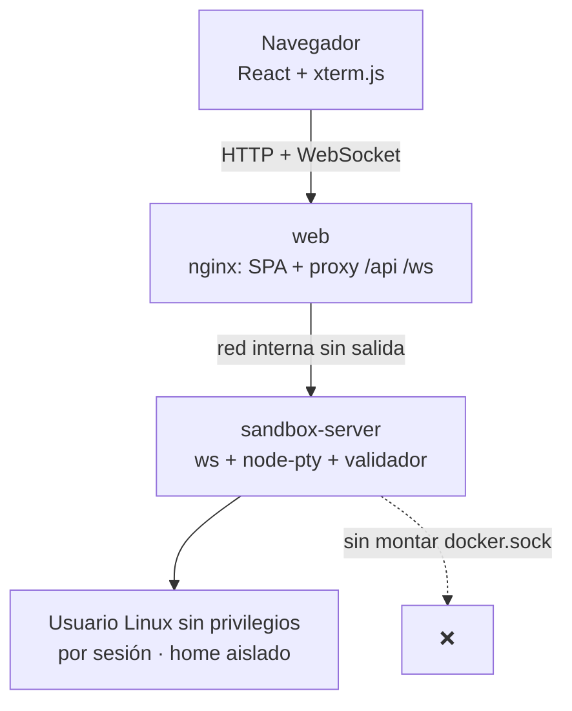
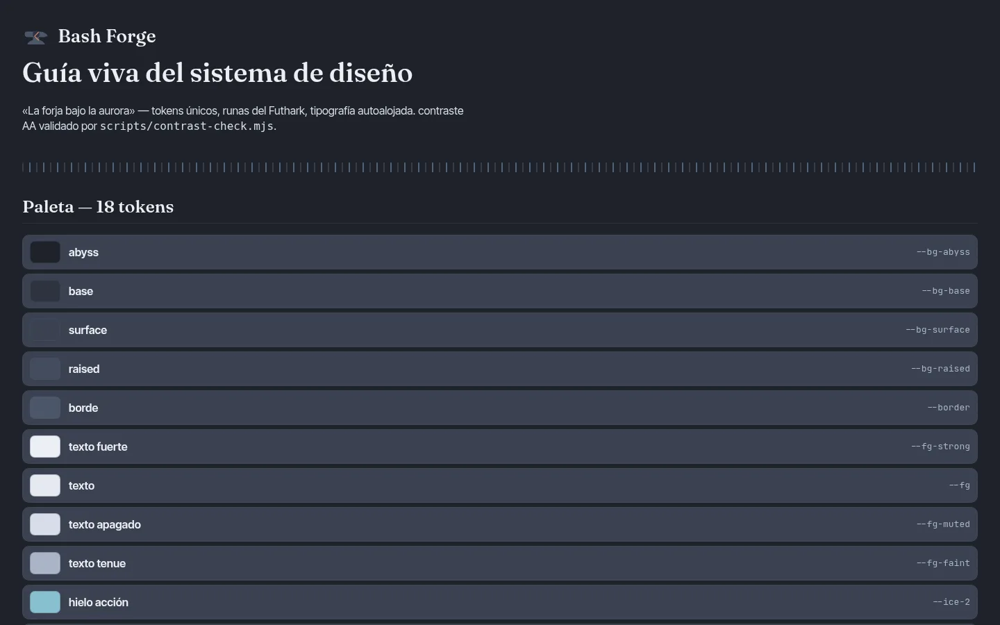
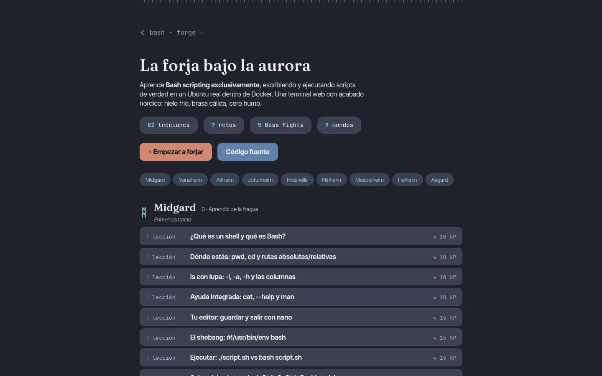

<p align="center">
  <picture>
    <source media="(prefers-color-scheme: dark)" srcset="docs/assets/banner-dark.svg"/>
    
  </picture>
</p>

<p align="center">
  <a href="https://github.com/D1se0/bash-forge/actions/workflows/ci.yml"></a>
  
  
  <a href="https://d1se0.github.io/bash-forge/"></a>
</p>

<p align="center"><strong>Aprende Bash scripting — solo Bash — forjando scripts de verdad</strong><br/>
en un Ubuntu real dentro de Docker, desde una terminal web con acabado nórdico.<br/>
<i>Nada de simulaciones: cada comando que escribes se ejecuta de verdad.</i></p>

---

ᚲ **¿Qué es?**

Bash Forge es una plataforma open source donde aprendes Bash escribiendo y ejecutando
scripts reales. Un servidor de terminales (PTY) dentro de un sandbox Ubuntu aislado,
82 lecciones + 7 retos + 5 Boss Fights con validación automática, y una estética
inspirada en la calma nórdica: *hielo frío, brasa cálida, cero humo*.

| | |
|---|---|
| ᛗ **Terminal real** | xterm.js → WebSocket → node-pty → `bash -l` en Ubuntu 24.04. nano, vim, colores 24 bit, Ctrl+C, TAB y redimensionado funcionan de verdad. |
| ᛞ **Validación automática** | Cada lección se comprueba ejecutando tu script en el sandbox (caja negra, con casos de prueba generados) y te devuelve un informe didáctico. |
| ᚸ **Aislamiento seguro** | Un usuario Linux sin privilegios por sesión, red interna sin salida a Internet, sin docker.sock montado. Verde/aurora cuando aciertas; brasa cuando fallas. |
| ᛈ **Progresión** | XP, rangos de forja (Aprendiz → Maestro Forjador), racha diaria, Boss Fights cronometrados y persistencia en volumen + localStorage. |
| ᛊ **Diseño vivo** | Sistema de diseño propio con tokens, 24 runas del Futhark y guía `/styleguide` en la propia app. |

<p align="center">
  <picture>
    
    
  </picture>
</p>

---

## Instalación en 3 pasos

Requisitos: Docker + Compose v2 (Linux, macOS o WSL2).

```bash
git clone https://github.com/D1se0/bash-forge.git
cd bash-forge
./bashforge install   # construye las imágenes
./bashforge up        # levanta y abre http://localhost:8080
```

> `./bashforge --help` lista todo: `status`, `logs`, `shell`, `backup`, `purge`… y `purge --yes` deja tu sistema sin rastro del proyecto.

<details>
<summary>ᛁ Arquitectura (clic para desplegar)</summary>



Detalle completo en [`docs/ARCHITECTURE.md`](docs/ARCHITECTURE.md); decisiones en [`docs/DECISIONS.md`](docs/DECISIONS.md).

</details>

<details>
<summary>ᛉ Seguridad en cinco líneas</summary>

- Un contenedor `sandbox` con usuario Linux sin privilegios **por sesión**; el tuyo no ve los demás.
- Red Docker `internal: true`: el sandbox **no tiene salida a Internet**.
- **Ningún montaje de `/var/run/docker.sock`** en ningún contenedor. Nunca.
- Los checks de las lecciones se ejecutan como otro usuario: el alumno no puede leerlos ni alterarlos.
- Modelo de amenazas completo en [`SECURITY.md`](SECURITY.md).

</details>

---

ᛝ **El currículum: nueve mundos de Yggdrasil**

| Mundo | Qué forjas | Runa |
|---|---|---|
| 0 · Midgard — *Primer contacto* | shell vs Bash, echo, rutas, nano, tu primer script ejecutable | ᛗ |
| 1 · Vanaheim — *Variables y parámetros* | comillas, `$@` vs `$*`, `${var:-x}`, `read`, `shift` | ᚠ |
| 2 · Alfheim — *Condicionales* | `[[ ]]`, todos los operadores de fichero, `case` | ᛊ |
| 3 · Jotunheim — *Bucles y control* | `for/while/until`, `read -r`, break/continue, trampas de subshells | ᚦ |
| 4 · Nidavellir — *Funciones y estructura* | funciones, `local`, `getopts`, `usage()`, códigos de salida | ᚨ |
| 5 · Niflheim — *E/S y procesos* | redirecciones, pipes, here-docs, `trap`, señales, fds | ᛁ |
| 6 · Muspelheim — *Arrays y texto* | arrays asociativos, `printf`, grep/sed/awk para scripts | ᚲ |
| 7 · Helheim — *Robustez* | `set -euo pipefail`, quoting defensivo, ShellCheck, `mktemp` | ᛉ |
| 8 · Asgard — *Proyectos finales* | backups con rotación, monitor de recursos, mini-proyectos | ᛟ |

Al final de cada mundo te espera un **Boss Fight** cronometrado: Garmr, Ratatoskr, Fenrir,
Jörmungandr, Fafnir, Nídhogg, Surtr, Hel… y Rágnarök, el proyecto integrador final.

---

ᚱ **Verificación y regreso visual**

Toda pieza pasa por build + tests + capturas revisadas en navegador real:

| | |
|---|---|
|  |  |
| *Guía de estilo viva en `/styleguide`* | *Sitio de documentación (GitHub Pages)* |

Evidencia completa (línea base, antes→después, cada fase) en [`docs/evidence/INDEX.md`](docs/evidence/INDEX.md).

---

ᚻ **Contribuir**

Leemos PRs con gusto por el detalle. Una lección nueva = un directorio en
`packages/lessons/<mundo>/<id>/` con `lesson.yaml`, teoría, reto, pistas y solución
que **pasa su propio check** (lo validamos en CI). Guía de autoría y estilo en
[`CONTRIBUTING.md`](CONTRIBUTING.md).

- ᛋ Usa commits convencionales (`feat(lessons): …`).
- ᛏ Añade capturas si tocas UI (revisamos contraste AA con `scripts/contrast-check.mjs`).
- ᛒ Lee [`SECURITY.md`](SECURITY.md) si encuentras algo que se sale del sandbox — gracias por avisar.

ᛜ **Mapa de ruta** (en orden de impacto): migración completa de la SPA a los tokens de diseño →
onboarding animado → mapa Yggdrasil interactivo → depurador visual «Forja lenta» →
docs-site React multiidioma → CI completa con Lighthouse. Decisiones actualizadas en
[`docs/DECISIONS.md`](docs/DECISIONS.md).

---

<p align="center">
  <sub>MIT · Elaborado con hielo, hierro y calma nórdica · ᚲ</sub>
</p>
