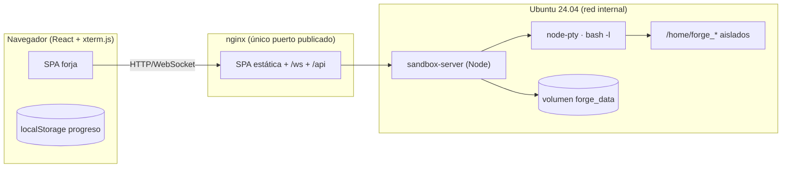

# Arquitectura — Bash Forge v2

## Componentes

| Pieza | Stack | Responsabilidad |
|---|---|---|
| `apps/web` | React + Vite + TS estricto + Tailwind-tokens + Zustand + xterm.js | SPA de la forja (mapa, terminal, pergamino, ajustes) |
| `apps/sandbox-server` | Node + ws + node-pty | secundario dentro del sandbox: sesiones, checks, lint, progreso |
| `packages/ui` | React + CSS tokens | sistema de diseño nórdico (tokens, runas, componentes) |
| `packages/lessons` | YAML + bash | currículum por mundos con validadores y soluciones |
| `packages/shared` | TS + Zod | contrato WS versionado y tipos del progreso |
| `docs-site` | React + Vite (SSG) | web de documentación en Pages con base `/bash-forge/` |
| `bashforge` + Makefile | Bash (ShellCheck limpio) | ciclo de vida local: install/up/doctor/backup/test/lint |

## Decisiones de red y seguridad

- **Solo `web` publica puerto** (`.env`); el sandbox vive en una red Docker `internal` sin salida a Internet.
- **Un usuario Linux por sesión** (`forge_*`, UID altos, `hidepid` cuando lo soporte el kernel): ni `docker.sock`, ni rootfs escribible fuera de `/tmp` y `/home`.
- Límites por sesión: `pids_limit`, `mem_limit`, `cpus`, `ulimit` de procesos/ficheros/CPU; TTL de sesiones inactivas.
- Verificación del alumno (9) ejecutada como usuario checker, nunca como el alumno.

## Protocolo WS (v2)

- JSON tipado con Zod, campo `v` obligatorio: `input`, `output`, `resize`, `ping/pong`, `session`, `exercise:check/result`, `lint:run/result`, `export:zip`, `error`.
- Reconexión con backoff exponencial + jitter y **restauración de sesión** por `sessionToken`; buffer de terminal de respaldo en el servidor.
- Detalle completo con ejemplos: `docs/PROTOCOL.md`.

## Datos y migraciones

- Progreso: servidor (volumen `forge_data`) + espejo en `localStorage`; resolución de conflictos «gana el más reciente, nunca se pierde XP».
- Formato versionado `ProgressSnapshot.v2`; migraciones accesorias versionadas y testadas.

## Riesgos conocidos heredados

- `node-pty` obliga a compilar dentro de la imagen del sandbox (paso herramientas de build — verificado).
- CentOS/kernels viejos sin `hidepid`: el plan B es ACL por grupo checker.
